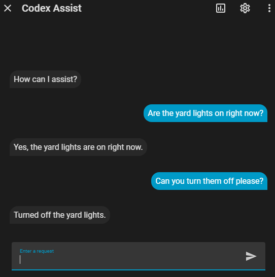

# Codex Assist for Home Assistant

<p align="center">
  
</p>

<p align="center">
  <a href="https://github.com/itsreverence/ha-codex-assist/releases"></a>
  <a href="https://github.com/itsreverence/ha-codex-assist/actions"></a>
  <a href="https://www.hacs.xyz/docs/use/repositories/dashboard/"></a>
</p>

Use OpenAI Codex / ChatGPT as a Home Assistant Assist conversation agent and AI Task provider.

Codex Assist signs in with Codex-style ChatGPT device-code auth. It keeps device control inside Home Assistant's normal exposed-entity safety model and does not require an OpenAI API key.

> Experimental: this project is not affiliated with OpenAI or Home Assistant. Codex backend compatibility may change with upstream Codex updates.

## Quick start

You need Home Assistant `2026.6.0` or newer, [HACS](https://www.hacs.xyz/docs/use/download/download/), and a ChatGPT account or plan with Codex access.

[](https://my.home-assistant.io/redirect/hacs_repository/?owner=itsreverence&repository=ha-codex-assist&category=integration)
[](https://my.home-assistant.io/redirect/config_flow_start/?domain=codex_assist)

### 1. Install

Codex Assist is in the HACS default catalog, so you do not add a custom repository.

1. In the Home Assistant sidebar, open **HACS**.
2. Search for **Codex Assist**, open it, and select **Download**.
3. Restart Home Assistant.

If it does not appear after a new release or a catalog change, try again later.

### 2. Sign in

Sign-in uses a device code, so you approve it in a browser. The browser can be on any device.

1. Go to **Settings → Devices & services → Add integration**, or use the button above. Search for **Codex Assist** and select it.
2. Select **Submit**. Home Assistant shows a web address and a short code.
3. Open that address in a browser, sign in to ChatGPT, and enter the code.
4. Return to Home Assistant and select **Submit**. If it says the code has not been approved yet, wait a few seconds and select **Submit** again.
5. Choose a chat model from the list, then select **Submit**.

If sign-in does not start or the code page reports an error, device-code login may be turned off for your account. OpenAI's [authentication guide](https://learn.chatgpt.com/docs/auth) says a personal account enables it in ChatGPT security settings, and a workspace admin controls it for a workspace. Home Assistant stores the sign-in itself. Do not paste tokens or copy them from Codex CLI or another tool.

Codex Assist supports one sign-in. To change accounts or sign in again, use **Reconfigure** on the existing entry.

### 3. Choose Codex Assist in your pipeline

1. Go to **Settings → Voice assistants**.
2. Open an existing assistant, or select **Add assistant**.
3. Set **Conversation agent** to **Codex Assist**.

### 4. Try a safe first request

Expose one harmless entity to Assist before you ask anything. A single light or a read-only sensor is a good choice. Open **Settings → Voice assistants** and use the **Expose** tab. [Safe Entity Exposure](https://github.com/itsreverence/ha-codex-assist/wiki/Safe-Entity-Exposure) has the steps and the entities to keep unexposed.

Then ask Assist about it by its own name. For example, if you exposed a light named Desk lamp:

```text
Is the desk lamp on?
```

<p align="center">
  
</p>

If something fails, start with [Troubleshooting](https://github.com/itsreverence/ha-codex-assist/wiki/Troubleshooting).

## What it does

**Assist conversations.** Codex Assist registers as a normal Assist conversation agent and streams replies. It reads and controls only the entities you expose to Assist, through Home Assistant's own Assist LLM API.

**AI Task.** It generates plain text or structured data, reads supported image attachments (up to four images, 10 MiB each, 20 MiB total), and generates images. See the [AI Task example](https://github.com/itsreverence/ha-codex-assist/wiki/Features-and-Options#run-a-data-task).

**Hosted web search.** Off by default. When on, the model can search for current information. The model is asked to keep raw URLs out of spoken replies, which is not guaranteed.

**Options.** The chat model comes from your account's own model list. See [Choosing a Model](https://github.com/itsreverence/ha-codex-assist/wiki/Choosing-a-Model) and [Features and Options](https://github.com/itsreverence/ha-codex-assist/wiki/Features-and-Options).

If a response ends before it completes, Codex Assist reports a failure. Part of the reply may already have been shown or spoken, so check a device's state before you repeat a request.

## Privacy and safety

- Codex Assist has no raw "call any Home Assistant service" bridge. Control goes through Home Assistant's Assist LLM API, so your list of Assist-exposed entities is the practical safety boundary.
- Each Assist request sends your message and the instructions Home Assistant builds for the model to the Codex service. Those instructions include an overview of your exposed entities. In Home Assistant 2026.10 the overview has names, areas, and aliases, and current states are sent only when the model asks for them. Other versions can differ. Expose only what you are comfortable sharing.
- Keep locks, alarms, garage doors, water shutoff valves, covers, and other sensitive devices unexposed unless you want Assist to control them.
- Hosted web search also sends the model's search queries to the Codex backend. AI Task prompts and supported attachments are sent when you run those tasks.
- Diagnostics redact access tokens, refresh tokens, and prompts. Review them before you share them.

The [security policy](SECURITY.md) has the full data and control boundaries.

## User guide

The [GitHub Wiki](https://github.com/itsreverence/ha-codex-assist/wiki) is the user manual.

- [Installation](https://github.com/itsreverence/ha-codex-assist/wiki/Installation)
- [Safe Entity Exposure](https://github.com/itsreverence/ha-codex-assist/wiki/Safe-Entity-Exposure)
- [Features and Options](https://github.com/itsreverence/ha-codex-assist/wiki/Features-and-Options)
- [Choosing a Model](https://github.com/itsreverence/ha-codex-assist/wiki/Choosing-a-Model)
- [Troubleshooting](https://github.com/itsreverence/ha-codex-assist/wiki/Troubleshooting)
- [Compatibility and Limitations](https://github.com/itsreverence/ha-codex-assist/wiki/Compatibility-and-Limitations)

## Project docs

- [User support](SUPPORT.md)
- [Security policy](SECURITY.md)
- [Contributing](CONTRIBUTING.md)
- [Architecture](docs/ARCHITECTURE.md)
- [Testing](docs/TESTING.md)
- [Release process](docs/RELEASING.md)
