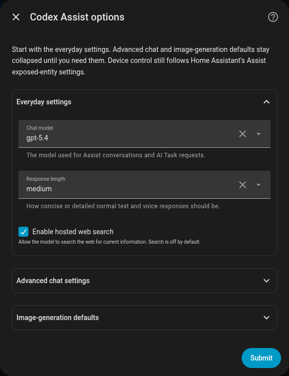
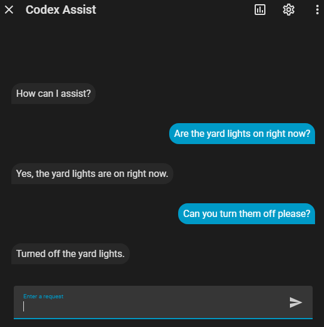

# Codex Assist for Home Assistant

  

  
  
  

Use OpenAI Codex / ChatGPT as a Home Assistant Assist conversation agent and AI Task provider.

Codex Assist signs in with Codex-style ChatGPT device-code auth. It keeps device control inside Home Assistant's normal exposed-entity safety model and does not require an OpenAI API key.

> Experimental: this project is not affiliated with OpenAI or Home Assistant. Codex backend compatibility may change with upstream Codex updates.

## Quick install

Requirements: Home Assistant `2026.6.0` or newer, HACS, and a ChatGPT account or plan with Codex access.

1. In Home Assistant, open **HACS → Integrations**.
2. Search for **Codex Assist**, open it, and select **Download**.
3. Restart Home Assistant.
4. In ChatGPT, enable **Settings → Security → Enable device code authorization for Codex** if it is available on your account.
5. Go to **Settings → Devices & services → Add integration**, or use the button above.
6. Search for **Codex Assist**, complete device-code sign-in, and choose a chat model from the account’s discovered list.
   Setup creates a conversation agent named **Codex Assist** and an AI Task entity named **Codex Assist AI Task**.
7. Select **Codex Assist** in your Assist pipeline.
8. Test with a harmless exposed entity first, such as a single light.

Codex Assist is included in HACS by default. You do not need to add this repository as a custom repository. If it does not appear immediately after a release or catalog change, refresh HACS data and try again later.

Home Assistant 2026.9 changed its schema converter. Codex Assist `0.4.4` fixes
setup failures mentioning `voluptuous_openapi` and Assist errors mentioning
`_Unsupported`. Update Codex Assist and restart Home Assistant; existing sign-in
and settings can be kept. See [Troubleshooting](https://github.com/itsreverence/ha-codex-assist/wiki/Troubleshooting).

## What it does

### Assist conversations

- Registers as a normal Home Assistant Assist conversation agent. One sign-in can serve several agents, each with its own name, prompt, and model.
- Streams replies while Codex is answering.
- Reads and controls only the entities Home Assistant exposes to Assist.
- Supports simple follow-up actions through Home Assistant's native Assist LLM API.
- Can optionally use hosted web search. Search is off by default. Visible results keep validated source links in a separate card, while the integration instructs the model to omit raw URLs and source blocks from spoken responses.

### AI Task

- Generates plain text or structured data from Home Assistant AI Task actions.
- Accepts supported image attachments on AI Task surfaces.
- Generates images with curated quality and size controls.
- Disables hosted web search for schema-constrained tasks so citation text cannot corrupt structured output.

### Agents and settings

Each conversation agent and the AI Task entity keep their own settings. To change
them, open **Settings → Devices & services → Codex Assist**, then open the menu next
to the agent and reconfigure it.

To add another agent, select **Add conversation agent** on the Codex Assist
integration page. Give it a name, a model, and its own system prompt. The new agent
appears as its own conversation entity, such as `conversation.kitchen_agent`, and
you can choose it in any Assist pipeline. All agents share the one Codex sign-in.

Each settings form keeps **Everyday settings** open and leaves the rest collapsed
until needed. Everyday controls are the chat model, response length, and hosted web
search. Conversation agents also have a multiline system prompt and reasoning
effort. The AI Task entity has reasoning effort and image-generation defaults, and
uses its own fixed instructions instead of a conversation prompt.

Upgrading from an earlier version keeps your existing settings, entity IDs, and Assist pipelines.
The old integration options become the first conversation agent and the AI Task
entity's settings.

The chat-model picker uses authenticated account discovery without adding guessed
model names. It refreshes when you open an agent's settings and every six hours while loaded.
New setups preselect the first model in the account’s priority order; existing selections stay unchanged.
Cached and unverified fallback lists are labeled. A saved model missing from the
list is retained with a label so changing another setting does not replace it.
See [Model discovery](docs/MODEL_DISCOVERY.md).

  

  

## Safety short version

Codex Assist does **not** expose a raw “call any Home Assistant service” bridge. It routes control through Home Assistant's Assist LLM API, so your **Assist exposed entities** list is the practical safety boundary.

Start with harmless lights or read-only questions. Keep locks, alarms, garage doors, water shutoff valves, covers, and other sensitive devices unexposed unless you deliberately want Assist control there.

Hosted web search sends the current model turn to the Codex backend when enabled. AI Task prompts and supported attachments are also sent to the backend when you run those tasks. See the [security policy](SECURITY.md) for the full data and control boundaries.

## User guide

The GitHub Wiki is the main user manual:

- [Installation](https://github.com/itsreverence/ha-codex-assist/wiki/Installation)
- [Features and Options](https://github.com/itsreverence/ha-codex-assist/wiki/Features-and-Options)
- [Choosing a Model](https://github.com/itsreverence/ha-codex-assist/wiki/Choosing-a-Model)
- [Safe Entity Exposure](https://github.com/itsreverence/ha-codex-assist/wiki/Safe-Entity-Exposure)
- [Troubleshooting](https://github.com/itsreverence/ha-codex-assist/wiki/Troubleshooting)
- [Compatibility and Limitations](https://github.com/itsreverence/ha-codex-assist/wiki/Compatibility-and-Limitations)

## Project docs

- [User support](SUPPORT.md)
- [Security policy](SECURITY.md)
- [Contributing](CONTRIBUTING.md)
- [Architecture](docs/ARCHITECTURE.md)
- [Testing](docs/TESTING.md)
- [Release process](docs/RELEASING.md)
